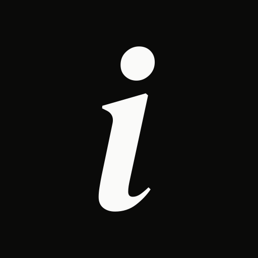

# iris-brand

El sistema de marca de iris: los design tokens, el CSS que sale de ellos, las fuentes, el logo, el
manual y las piezas. Es la única fuente: si un valor no está en los tokens, no existe; si cambia,
cambia acá y cada app lo toma cuando quiere. Este repo no modifica ninguna app.

iris es un SaaS de agentes que atienden a los clientes y manejan la cuenta de un vendedor de
Mercado Libre de punta a punta, con la autonomía que el dueño le da.

## Qué hay adentro

| Carpeta | Qué tiene |
|---|---|
| [`tokens/`](tokens/) | La fuente de todo, en DTCG 2025.10: `foundation.tokens.json` (primitivos, tipografía, espacio, forma, vidrio y movimiento), `themes/dark.tokens.json` y `themes/light.tokens.json` (los roles de color de cada modo) e `iris.resolver.json` (los dos modos, con el oscuro por default). |
| [`css/`](css/) | Escrito a mano y sin un valor propio: `fonts.css` (las caras), `tailwind.css` (el puente a Tailwind v4) y `glass.css` (el vidrio). |
| [`dist/`](dist/) | Generado y commiteado: `tokens.css` (las variables `--iris-*` de los dos modos) y `design-system.json` (lo que va a leer Claude Design). No se edita a mano. |
| [`fonts/`](fonts/) | Los WOFF2 de DM Serif Display itálica, IBM Plex Sans 400 y 500 e IBM Plex Mono 400, con sus licencias OFL. Procedencia y sumas en `fonts/README.md`. |
| [`logo/`](logo/) | El ícono, el logotipo y el lockup en SVG (contornos, sin fuentes), más el favicon y los PNG. En `logo/png/`, el logotipo y el lockup con fondo transparente y el ícono en más tamaños, para lo que no lee SVG (Canva, Google Docs y Slides, Keynote, Notion, la firma de mail); `logo/preview.png` los muestra todos. Qué va dónde: `logo/README.md`. |
| [`guide/`](guide/README.md) | El manual, en 15 capítulos. |
| [`pieces/`](pieces/) | Las piezas terminadas, en HTML con su PNG. En `pieces/redes/`, la foto de perfil, la portada de Facebook, las destacadas de Instagram y las plantillas de posts; en `pieces/linkedin/`, el banner del perfil y la portada y el logo de la página de empresa. |
| [`scripts/`](scripts/) | El build: `terrazzo.mjs` (el parseo que comparten el build y el test) y `design-system.mjs` (escribe `dist/design-system.json`). La config de Terrazzo es `terrazzo.config.mjs`, en la raíz. |
| [`test/`](test/) | La guarda que corre con cada build, con los esquemas oficiales de DTCG en `test/schemas/`. |

## Usarlo en una app

### Instalar

Como dependencia de git, no como submódulo. El repo vive en la organización `Iris-Agents` de GitHub.

```sh
pnpm add github:Iris-Agents/iris-brand#semver:^1
```

- pnpm elige el tag más nuevo de la versión 1, y el lockfile fija su commit.
- El repo es público y `dist/` está commiteado: no hace falta un token ni compilar nada.
- Terrazzo y colorjs.io son dependencias de desarrollo de este repo: nunca entran a una app ni al
  Worker.

### Importar

En el CSS principal, después de Tailwind:

```css
@import "tailwindcss";
@import "iris-brand/fonts.css";     /* las caras: DM Serif Display itálica, IBM Plex Sans y Plex Mono */
@import "iris-brand/tokens.css";    /* las variables --iris-*, en oscuro y en claro */
@import "iris-brand/tailwind.css";  /* las utilidades: bg-canvas, text-fg, rounded-card… */

html {
  font-synthesis: none;             /* que el navegador no invente negritas */
}
```

- Probado con Vite 8 y `@tailwindcss/vite` 4.3: las rutas de `fonts.css` se reacomodan solas y los
  WOFF2 salen como assets. Con la CLI de Tailwind no se reacomodan.
- `tailwind.css` pisa `font-sans` y `font-mono` a propósito: la familia por default de la app pasa
  a ser IBM Plex Sans. No bloquea la paleta de Tailwind ni redefine los nombres de shadcn; el puente
  a shadcn, si hace falta, queda en la app.
- El paquete también exporta `iris-brand/design-system.json`. Una app no lo necesita.
- El logo y las fuentes se importan por su ruta: `import icono from "iris-brand/logo/icon.svg"`,
  `iris-brand/logo/favicon.ico`, `iris-brand/fonts/…`. Nunca se copian a mano a la app.
- Las plantillas de redes vienen en `iris-brand/pieces/…`. Un post armado en otro proyecto se
  renderiza con `node_modules/iris-brand/pieces/redes/_base/render.sh --plantilla …`: el comando
  está en `pieces/redes/plantillas.md`, sección 6.

### En el markup

Se lee por rol, nunca por gris:

```html
<body class="bg-canvas text-fg text-body">
  <article class="bg-surface border border-line-subtle rounded-card">
    <h2 class="text-section">
      Agentes expertos<br>
      <span class="text-section-signature font-signature italic text-fg-secondary">a cargo de tu e-commerce.</span>
    </h2>
    <span class="font-mono text-mono text-fg-tertiary">10:40 · id 4418</span>
  </article>
</body>
```

| Qué | Nombres |
|---|---|
| Colores, con cualquier prefijo (`bg-`, `text-`, `border-`, `fill-`…) | Fondos: `canvas` `surface` `raised` `hover` `selected` · Texto: `fg` `fg-secondary` `fg-tertiary` `fg-placeholder` `fg-disabled` `on-action` · Bordes: `line-subtle` `line` `line-control` · Acción: `action` `action-destructive` `focus` `selection` `backdrop` · Estados, sólo en el glifo: `status-attention` `status-working` `status-failed` `status-done` `status-idle` · Datos: `data-series` `data-comparison` `data-grid` `link-underline` |
| Radios | `rounded-chip` `rounded-control` `rounded-card` `rounded-panel` `rounded-frame`; las píldoras, `rounded-full` |
| Estilos de texto (tamaño, interlineado, tracking y peso) | `text-hero` `text-hero-signature` `text-section` `text-section-signature` `text-title` `text-lede` `text-body` `text-reading` `text-ui` `text-label` `text-eyebrow` `text-mono` |
| Familias | `font-sans` `font-signature` `font-mono` |

Sin Tailwind, las mismas variables: `var(--iris-color-bg-canvas)`, `var(--iris-radius-card)`. El
nombre es el id del token con guiones: `color.text.secondary` es `--iris-color-text-secondary`. Al
CSS sólo salen los roles: ningún primitivo (`neutral-dark.*`, `signal.*`) llega a una app.

### El vidrio

Sólo si la app tiene una capa que flota, después de `tokens.css`:

```css
@import "iris-brand/glass.css";
```

- `.glass-bar` es la barra flotante (la nav de la landing). Lleva sólo `text-fg`,
  `text-fg-secondary`, el CTA de tinta y el foco.
- `.glass-panel` es lo que flota con texto: ⌘K sin cortina, popovers y menús, la aprobación cuando
  flota.
- Nunca en el contenido ni en una pieza estática, nunca vidrio sobre vidrio, nunca más de dos a la
  vez. Aparece y se va con `opacity`, en el mismo elemento.
- Sin soporte de `backdrop-filter`, con `prefers-reduced-transparency` o con `prefers-contrast:
  more`, vuelve solo a la superficie lisa.

### Oscuro y claro

- `<html data-theme="dark">` o `data-theme="light"` fija el modo. Sin atributo sigue al sistema, y
  si el sistema no pide claro, va oscuro.
- No hace falta `dark:` para los colores de la marca: la utilidad lleva la variable y el modo la
  resuelve. `tokens.css` también pone `color-scheme`.
- El oscuro es la identidad: la landing y las piezas van siempre en oscuro. El claro existe para la
  app.
- El `<meta name="theme-color">` de cada página es el `bg.canvas` de su modo: #0A0A09 o #FAFAF9.

### Por qué no un submódulo

Un submódulo hay que clonarlo con `--recursive` o la carpeta queda vacía, apunta a un commit suelto
y no a una versión, y es fácil commitear uno desactualizado sin darse cuenta. Con la dependencia, la
versión queda escrita en el `package.json` y en el lockfile, y `pnpm install` deja todo listo. Más
adelante el paquete se puede publicar en npm (por ejemplo `@iris-agents/brand`, si está libre).

## Tomar una versión nueva

En la app:

```sh
pnpm update iris-brand                              # la 1.x más nueva
pnpm add github:Iris-Agents/iris-brand#semver:^2      # pasar a una major, a mano
```

Ninguna app cambia sola: `pnpm install` respeta el lockfile, y una app en `^1` nunca recibe un 2.0.

| Cambio | Versión |
|---|---|
| Cambiar el valor de un token, o agregar uno | minor: 1.2.0 → 1.3.0 |
| Renombrar o borrar un token | major: 1.x → 2.0.0 |
| Algo que no toca ningún token (el manual, una pieza, un informe) | patch: 1.3.0 → 1.3.1 |

Un token que va a desaparecer lleva `$deprecated` una versión antes, con su reemplazo, y se borra
en la major siguiente:

```json
"muted": { "$type": "color", "$value": "{color.neutral-dark.10}", "$deprecated": "Usar color.text.secondary." }
```

## La marca en una pantalla

**El alma.** Elegante, oscura y minimalista. Monocromo: la jerarquía sale de la luz y la tinta es
el acento. Sin sombras, sin glow y sin gradientes llamativos; el único blur es el vidrio.

**El logo**, en tres piezas según el lugar. Nunca se tipea: se usa el SVG.

| Pieza | Archivo | Dónde va |
|---|---|---|
| El ícono: una «i» minúscula de DM Serif Display itálica en `brand.white` sobre un cuadrado `brand.black`, a sangre | `logo/icon.svg`; de 16 a 23 px, `logo/icon-small.svg` | Espacios cuadrados: avatar, favicon, ícono de app, conector de Claude. |
| La marca: «iris agents», todo en minúscula, en DM Serif Display itálica | `logo/wordmark.svg` | Donde el ícono ya está cerca. |
| Juntos: el logo principal | `logo/lockup.svg`, `logo/lockup-on-light.svg` | Todo lo demás: la web, el mail, los documentos, el banner. |

En texto corrido se escribe «iris». «Iris Agents», con mayúsculas, sólo como nombre formal: página
de empresa, facturas, contratos.

**Tipografía.** Tres familias, dos pesos.

| Familia | Para qué |
|---|---|
| DM Serif Display itálica, la firma | Sólo en tres lugares: el logotipo, la i del ícono y la segunda línea de un titular de dos líneas (desde 32 px, en `text.secondary`). |
| IBM Plex Sans 400 y 500 | Todo lo que se lee y se opera. No hay tercer peso. |
| IBM Plex Mono 400 | Sólo datos: ids, horas, nombres de tools, atajos. |

**Color.** La base; la paleta completa, con OKLCH y contraste, está en el capítulo 04.

| Token | Oscuro | Claro |
|---|---|---|
| `brand.black` · `brand.white` | #0A0A09 · #FAFAF9 | igual |
| `bg.canvas` · `bg.surface` · `bg.raised` | #0A0A09 · #111110 · #181816 | #FAFAF9 en los tres |
| `text.primary`, que también es la tinta del CTA y el foco | #EDEDEA | #1A1917 |
| `text.secondary` · `text.tertiary` | #BFBEB9 · #9B9A96 | #4E4D49 · #686764 |
| `border.subtle` · `border.default` | #2C2B29 · #3A3937 | #E3E3E1 · #CECECB |

**Los cinco estados.** Siempre glifo más palabra, o glifo más leyenda. Ninguna forma se repite y el
color va sólo en el glifo.

| Glifo | Estado | Oscuro | Claro | Qué dice |
|---|---|---|---|---|
| ● | Te toca | #F7AC4D | #AD721C | El dueño tiene que decidir. Es el único ● del set. |
| ◐ | iris trabajando | #50A064 | #266739 | iris lo está haciendo. En lo animado late suave dos veces y queda quieto; nunca gira. |
| ✕ | Falló | #E66E68 | #BC3732 | Algo no se pudo hacer. Es el único que también va como texto: botón destructivo, error de campo. |
| ✓ | Resuelto | #9B9A96 | #686764 | Hecho, en silencio: es `text.tertiary`. |
| ○ | Esperando o sin declarar | #EDEDEA | #4E4D49 | Espera a un tercero, o nadie lo configuró. |

No hay un color más: un azul quedaría pegado al cian de Mercado Pago. Los SVG de cada glifo están
en el capítulo 04.

**El vidrio.** Ahumado y sólo en la capa que flota: la barra de la landing, ⌘K, popovers, la
aprobación cuando flota. En oscuro, la barra es `bg.surface` al 80 % y el panel `bg.raised` al
94 %, con blur de 24 px, saturate 1,4, borde blanco al 14 % y una línea de luz inset de 1 px blanco
al 10 %. Sin lente ni refracción, y sin glifos de estado ni texto gris en la barra.

**En lo público, el resultado.** En el banner, las redes, la landing y las OG cada fila dice qué
logró iris: «Contestó 40 preguntas», «Resolvió 3 reclamos», «Generó 3 ventas adicionales»,
«Adhirió a una promoción», «Mejoró la reputación». Sin «Cliente ·», «Producto ·» ni «Vendedor ·»:
los nombres de los agentes quedan para la app. En la tarjeta de aprobación el antetítulo es
«Propuesta». El titular del banner y de la portada de Facebook es «Agentes expertos / *a cargo de tu
e-commerce.*», y son las dos únicas piezas con un degradé radial (blanco al 4 %).

**Mercado Libre.** Se nombra como un hecho («tu cuenta de Mercado Libre», «para vendedores de
Mercado Libre»), con iris siempre más grande. Nunca su logo, sus colores ni un diseño parecido;
nunca «partner», «oficial», «certificado», «aliado» ni «powered by»; nunca en el nombre de la app,
de un módulo ni de una cuenta; «expertos» no va pegado a «Mercado Libre». En portugués es «Mercado
Livre»; en público nunca «MercadoLibre» ni «MeLi». El descargo va en el pie de la landing. El
detalle, en el capítulo 12.

**Lo que no.** El violeta, el amarillo de Mercado Libre, juegos con el iris del ojo, «el primer
empleado de IA», Playfair, mascotas, robots, destellos, emojis, glow, sombras, gradientes
llamativos, «piloto automático», «24/7», «bot» y los superlativos.

**El manual:** [00 Cómo se usa](guide/00-como-se-usa.md) ·
[01 Esencia](guide/01-esencia.md) · [02 Nombre](guide/02-nombre.md) ·
[03 Logo e ícono](guide/03-logo-e-icono.md) · [04 Color](guide/04-color.md) ·
[05 Tipografía](guide/05-tipografia.md) ·
[06 Forma, espacio y movimiento](guide/06-forma-espacio-movimiento.md) ·
[07 Datos y gráficos](guide/07-datos-y-graficos.md) · [08 Piezas propias](guide/08-piezas-propias.md) ·
[09 Voz y tono](guide/09-voz-y-tono.md) · [10 iris adentro de Claude](guide/10-iris-en-claude.md) ·
[11 Aplicaciones](guide/11-aplicaciones.md) · [12 Mercado Libre y otras marcas](guide/12-mercado-libre.md) ·
[13 Accesibilidad](guide/13-accesibilidad.md) · [14 Recursos y versionado](guide/14-recursos-y-versionado.md).
Lo que el manual no cubre no se inventa: se le pregunta a Franco, y la respuesta entra al manual.

## Para quien mantiene el repo

### Requisitos y comandos

Node y pnpm (probado con Node 25 y pnpm 11). Para las piezas y los exportes del logo, además,
Google Chrome en `/Applications` (macOS) e internet: las piezas cargan sus fuentes de Google Fonts.

```sh
pnpm install   # Terrazzo y colorjs.io
pnpm build     # tz build → dist/tokens.css; scripts/design-system.mjs → dist/design-system.json; el test
pnpm test      # sólo el test: node --test test/*.test.mjs
```

`pnpm build` escribe `dist/` y después corre el test. Si el test falla, el comando sale con error y
ese `dist/` no se commitea. `pnpm test` solo también falla si `dist/` no es exactamente lo que
generan los tokens: un `dist/` viejo o editado a mano no pasa.

El paquete no tiene script `prepare`, y no se le agrega: con uno, pnpm instalaría las dependencias
de desarrollo y compilaría en cada instalación de cada app.

### Qué frena el test

- **Esquemas:** los tres archivos de tokens y el resolver validan contra los esquemas oficiales de
  DTCG 2025.10, y el resolver arma los dos modos con el oscuro por default. El validador es un
  draft-07 propio (`test/lib/json-schema.mjs`), para no sumar una dependencia.
- **Alias y modos:** todo alias resuelve en los dos modos; un rol apunta sólo a foundation, nunca a
  otro rol; oscuro y claro tienen los mismos roles; los roles son sólo de color; ningún token lleva
  `$extensions`; todo token tiene `$type`, y todo color y todo rol, `$description`.
- **Color:** el hex coincide con sus componentes OKLCH, ningún color cae fuera de sRGB, y
  «resuelto» es el mismo gris que `text.tertiary`.
- **Contraste:** los 155 pares llegan a WCAG 2.2 AA sobre los cinco fondos de su modo: 4,5:1 el
  texto; 3:1 los bordes de control, los glifos de estado, el foco, las series y el subrayado.
  `text.disabled` queda en 3:1 o más. APCA se imprime al lado, como dato.
- **Tipografía:** doce estilos, sólo pesos 400 y 500, nada debajo de 12 px, el tracking que le toca
  a cada familia y tamaño, y las dos líneas de un titular con el mismo tamaño e interlineado. La
  firma, sólo en la segunda línea de un titular, desde 32 px y en 400.
- **Vidrio:** cada tinte es el neutro que dice su nombre, la barra es `bg.surface` y el panel
  `bg.raised` con alfa, y el texto permitido pasa con blanco o negro puro detrás aunque el
  desenfoque no se pinte.
- **`dist/`:** es exactamente lo que genera el build, ningún primitivo sale al CSS y los bloques
  del claro traen sólo color.
- **`css/`:** `tailwind.css` y `glass.css` sólo nombran variables que existen y no escriben un valor
  propio; ningún nombre de `tailwind.css` choca con shadcn ni con la paleta de Tailwind, salvo
  `font-sans` y `font-mono`, a propósito; están todos los roles de color menos el vidrio, que va por
  `glass.css`; cada familia de los tokens está en `fonts.css` y cada archivo que nombra existe.
- **Piezas:** cada variable de `pieces/redes/_base/brand.css` tiene su token, con el mismo valor.

### Cambiar un token

1. Se cambia en `tokens/`, nunca en `dist/` ni en el CSS de una app. Un valor nuevo va en
   `foundation.tokens.json`; a qué valor apunta un rol va en `themes/dark.tokens.json` y
   `themes/light.tokens.json`, que tienen siempre los mismos nombres.
2. Un color se escribe en OKLCH con su `hex` al lado; si no coinciden, el test dice qué hex dan los
   componentes. Un rol apunta a foundation: `"$value": "{color.neutral-dark.9}"`.
3. Un rol de color nuevo suma su línea en `css/tailwind.css`.
4. `pnpm build`, y se mira la diferencia de `dist/`: tiene que ser la esperada.
5. Si el valor también está copiado en `pieces/redes/_base/brand.css`, el test lo marca: se corrige
   ahí y se regeneran las piezas.
6. Se actualiza el capítulo del manual que nombra ese valor.

### Publicar una versión

1. En una rama: el cambio y el `version` del `package.json`, según la tabla de semver.
2. `pnpm build` después de subir la versión: `dist/design-system.json` la lleva adentro
   (`meta.source`) y el test falla si quedó la vieja.
3. Se commitea todo, `dist/` incluido. Aprueba Franco.
4. El tag, anotado, con qué tokens cambiaron y por qué:
   ```sh
   git tag -a v1.3.0 -m "v1.3.0: qué tokens cambiaron y por qué"
   git push --follow-tags
   ```
   Un tag publicado no se mueve ni se borra: si salió mal, sale otra versión.
5. Se re-sincroniza el Design System de claude.ai, cuando exista, y se regeneran las piezas que usan
   lo que cambió.

### Regenerar las piezas

```sh
pieces/redes/_base/render-all.sh
```

Lee `pieces/redes/_base/piezas.tsv`, una línea por PNG, y tarda un par de minutos. Una sola pieza,
con la salida en ruta absoluta (con `?guias` sale la versión con las zonas seguras, que nunca se
publica):

```sh
pieces/redes/_base/render.sh <pieza.html> <ancho> <alto> <salida.png>
```

Después se miran las PNG con glifos y se repasa la lista de control de
`pieces/redes/plantillas.md`. Los PNG y el `.ico` de `logo/` se exportan desde sus SVG sólo
cuando cambia un SVG; el cómo está en `logo/README.md`.

### El Design System de claude.ai (paso futuro)

Todavía no está publicado. Cuando se publique, el Design System «iris» se arma con
`dist/design-system.json`, `guide/`, `logo/` y `fonts/`, y se re-sincroniza con cada versión. El
movimiento no viaja, porque el tipo no lo lee: va escrito en el README de ese Design System. El
procedimiento se escribe en el capítulo 14 con la primera publicación.

## Claude Design y Figma

- **Claude Design** no instala nada: lee el Design System «iris» publicado en claude.ai. Los
  canvases del banner, de las OG y de las piezas lo eligen como design system.
- **Figma, Penpot o cualquier otra herramienta** toman `tokens/` con un importador de DTCG; si no
  lee el resolver, se importa `foundation.tokens.json` más el tema que haga falta. Cada color trae
  su `hex` para las que no leen OKLCH. El logo sale de los SVG de `logo/` y las fuentes, de `fonts/`.
- Cuando exista la página /brand de la landing, lo mismo se baja de ahí.
- Lo que se diseña afuera no define valores: un valor nuevo entra como token acá.

## Licencias

- **El código y los tokens:** MIT ([`LICENSE`](LICENSE)).
- **Las fuentes** (`fonts/`): SIL Open Font License 1.1, cada una con su archivo
  (`fonts/OFL-DMSerifDisplay.txt` y `fonts/OFL-IBMPlex.txt`).
- **El nombre, el logo y el ícono** (`logo/`): son marca de Iris Agents. La licencia MIT no los
  cubre: no se usan para otra cosa que iris, ni de una forma que sugiera respaldo o relación con
  iris.
